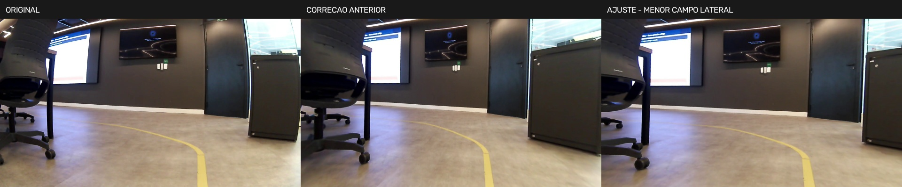
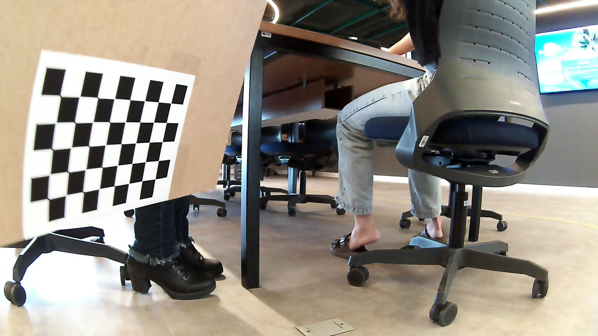
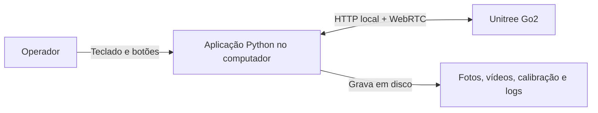
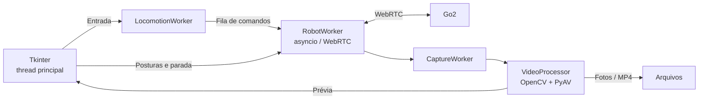

# Go2 — câmera e teleoperação via WebRTC

Aplicação Python para visualizar a câmera do **Unitree Go2**, tirar fotos,
gravar vídeos e controlar o robô pelo Wi-Fi local.

**Python 3.12 · WebRTC · Tkinter · OpenCV · PyAV · Loguru**

| Câmera e captura | Controle | Processamento |
| --- | --- | --- |
| Vídeo ao vivo, fotos JPG e gravação MP4/H.264 | Teclado, botões, posturas e reconexão manual | Calibração com tabuleiro e correção de prévia, fotos e vídeos |

[Instalação](#instalação) · [Como usar](#como-usar) · [Calibração](#calibração-e-imagens) · [Arquitetura C4](#arquitetura-c4) · [Problemas e soluções](#problemas-e-soluções)

## Como o projeto evoluiu

| Etapa | O que foi feito |
| --- | --- |
| Preparação | Instalação das dependências e criação do ambiente Python em `~/go2_env` |
| Primeira conexão | Recepção da câmera e captura de fotos com `foto_webrtc.py` |
| Primeiros experimentos | Teleoperação e tentativa de correção fisheye com parâmetros fixos |
| Aplicação atual | Interface Tkinter, tarefas separadas em threads, logs, diagnóstico e gravação |
| Calibração | Coleta com tabuleiro, cálculo dos parâmetros e integração da correção |
| Organização | Fotos originais, corrigidas e comparações em pastas separadas |

A comunicação usada é **WebRTC**: HTTP na negociação inicial, uma trilha de
vídeo e um DataChannel para comandos. O clone de `unitree_sdk2_python` fez parte
dos registros iniciais; a aplicação atual usa o driver `unitree-webrtc-connect`.

<details>
<summary>Ver a preparação inicial pelo terminal</summary>

Estes são os comandos iniciais organizados. Para instalar a versão atual com
as dependências fixadas, siga a próxima seção.

```bash
sudo apt update
sudo apt install -y git python3-pip python3-venv portaudio19-dev

mkdir -p ~/go2_env/foto_webrtc
python3 -m venv ~/go2_env
source ~/go2_env/bin/activate
cd ~/go2_env/foto_webrtc

python -m pip install --upgrade pip
python -m pip install unitree_webrtc_connect opencv-python aiortc numpy
```

No início, o código e o ambiente virtual ficavam juntos em `~/go2_env`.
Hoje o ambiente fica em **`.venv/`**, separado do código e gerenciado pelo `uv`.
O clone do SDK oficial, para consulta, era feito separadamente:

```bash
cd ~
git clone https://github.com/unitreerobotics/unitree_sdk2_python.git
```

Registro: [issue #17 do ProIC-2026](https://github.com/laismedeiros19/ProIC-2026/issues/17).
O SDK oficial é uma referência separada e não é necessário para rodar esta aplicação.

</details>

## Instalação

**Ambiente de referência:** Linux com sessão gráfica, Python 3.12 e Tkinter.
Faça a instalação com acesso à internet; só depois mude para o Wi-Fi do robô.
Para receber a câmera e controlar o Go2, o computador precisa estar conectado
ao Wi-Fi AP do robô, acessível em **`192.168.12.1`**.

### 1. Instalar os pacotes do sistema

Em Ubuntu/Debian, com os pacotes correspondentes ao seu Python:

```bash
sudo apt update
sudo apt install -y git curl make python3 python3-pip python3-venv \
  python3-tk python3-dev portaudio19-dev build-essential libgl1 libglib2.0-0 \
  iproute2 iputils-ping
```

Tkinter fornece a interface; PortAudio é necessário para dependências do driver,
mesmo quando usamos apenas vídeo.

### 2. Baixar o projeto

```bash
mkdir -p ~/projetos
cd ~/projetos
git clone https://github.com/Nous-Ecossistema/observatorio-unitree-go2-setup.git go2_env
cd go2_env
```

Se já tem o código em `~/go2_env`, entre nessa pasta. Execute os próximos comandos
na **raiz do projeto**, onde ficam `pyproject.toml` e `uv.lock`.
Confira antes de continuar:

```bash
pwd
ls pyproject.toml uv.lock foto_webrtc/teste_video.py
```

Os três arquivos devem ser encontrados. Em outro terminal, volte à pasta onde
você clonou o projeto: `~/projetos/go2_env` neste exemplo.

### 3. Instalar o uv e preparar o ambiente

```bash
curl -LsSf https://astral.sh/uv/install.sh | sh
export PATH="$HOME/.local/bin:$PATH"

# Sair do ambiente antigo, se estiver ativo.
if [ -n "${VIRTUAL_ENV:-}" ]; then deactivate; fi
uv sync --locked
uv pip check --python .venv/bin/python
```

O `uv` cria `.venv/` e instala as versões registradas no lock. Não é necessário
ativar o ambiente manualmente ao usar `uv run`. A instalação deve terminar sem
erros, e `uv pip check` deve informar que os pacotes são compatíveis.
Se aparecer `uv: command not found` em outro terminal, reabra o terminal ou
repita o comando `export PATH` acima.

<details>
<summary>Ver as dependências Python do projeto</summary>

| Pacote | Versão declarada | Função |
| --- | --- | --- |
| `unitree-webrtc-connect` | 2.2.0 | Comunicação com o Go2 |
| `aiortc` | 1.15.0 | WebRTC |
| `av` | 17.1.0 | Frames e gravação MP4 |
| `opencv-python` | 5.0.0.93 | Imagens e calibração |
| `numpy` | 2.5.3 | Matrizes e arquivos NPZ |
| `loguru` | 0.7.3 | Logs |

As declarações ficam em [pyproject.toml](pyproject.toml); as dependências
transitivas também são fixadas em [uv.lock](uv.lock).

</details>

## Como usar

Siga esta ordem no primeiro uso. Para fotografar e gravar, basta receber o vídeo;
os comandos de levantar e locomover são uma etapa separada.

### 4. Conferir a instalação sem o robô

```bash
uv run --locked go2-env --help
uv run --locked python calibrar_camera_go2.py --verificar-dependencias
uv run --locked python -c "import av; print(av.codec.Codec('libx264', 'w').name)"
uv run --locked go2-env --testar-janela
```

**Resultado esperado:** lista de opções da aplicação, dependências com `OK`,
encoder `libx264` disponível e uma janela de teste. Essa janela não conecta
ao Go2 e não mostra sua câmera; feche com Esc antes de continuar.
Se houver erro de Tkinter, Qt ou display, resolva a sessão gráfica primeiro.

### 5. Conectar o computador ao Go2

1. Ligue o Go2 e aguarde sua inicialização, em um local adequado para o ensaio.
2. Confirme que o hotspot Wi-Fi do robô está disponível em modo AP.
3. Nas configurações Wi-Fi do computador, conecte à rede do Go2 usando as
   credenciais do seu equipamento. Nome da rede e senha dependem da configuração.
4. Encerre outras sessões da câmera, incluindo o calibrador, antes de abrir a aplicação.
5. Confira a rota para o endereço usado pelo projeto:

```bash
ip route get 192.168.12.1
ping -c 3 192.168.12.1
```

A rota deve usar a interface conectada ao Go2. Respostas ao ping ajudam a
confirmar acesso, mas ausência de resposta não comprova que o WebRTC falhará.
O Wi-Fi do robô pode não fornecer internet; as dependências já devem estar
instaladas. Este modo usa o endereço **192.168.12.1**, sem servidor adicional.

### 6. Abrir a câmera

Na raiz do projeto, veja se a calibração padrão existe:

```bash
ls calibracoes_go2/20261021_180527_uaywafbe/calibracao.npz
```

| Situação | Comando para iniciar |
| --- | --- |
| NPZ padrão presente | `make run` |
| NPZ ausente ou primeiro teste sem correção | `make run ARGS="--sem-correcao"` |
| Usar outro NPZ pinhole | `make run ARGS="--calibracao caminho/calibracao.npz"` |

Substitua `caminho/calibracao.npz` pelo arquivo real. Se não usar `make`,
execute `uv run --locked go2-env` com as mesmas opções.

**Resultado esperado:** conexão em **Conectado** e imagem ao vivo. Com a
calibração padrão compatível, a prévia exibe **CAMERA CORRIGIDA**. Se o robô
não estiver acessível, a interface fica em modo offline: confira a rede e
pressione F5 ou clique em Reconectar. Para iniciar sem correção depois de um
erro no NPZ, feche a aplicação e execute o comando correspondente na tabela.

### 7. Tirar uma foto e gravar um vídeo

1. Aguarde a imagem ao vivo atualizar e clique na janela para dar foco.
2. Pressione **P** ou clique em **Foto**. Confira a mensagem `Foto salva`.
3. Com correção ativa, a foto abre em outra janela. Use **Fechar foto** antes
   de continuar com os atalhos da janela principal.
4. Pressione **V** para iniciar uma gravação. Confira o indicador **REC**.
5. Aguarde alguns segundos e pressione **V** novamente. Confira `Vídeo salvo`.
6. Pressione **Esc** para encerrar e aguarde o programa voltar ao terminal.

| Saída padrão | Onde encontrar |
| --- | --- |
| Foto sem correção | `fotos/originais/foto_campo_*.jpg` |
| Foto corrigida | `fotos/corrigidas/foto_corrigida_*.jpg` |
| Original da foto corrigida | `fotos/originais/*_original.png` |
| Vídeo, sem áudio | `foto_webrtc/capturas_go2/videos/video_campo_*.mp4` |
| Logs da sessão | `logs/` |

O `*` representa a data/hora adicionada ao nome, não um nome literal.
Abra os arquivos no visualizador de imagens ou no reprodutor de vídeo do
computador. Foto e gravação são recusadas sem frame recente ou quando a
resolução não corresponde à calibração. Evite encerrar o processo à força
para que o MP4 seja finalizado.

### 8. Controlar o robô pelo teclado ou pelos botões

Clique na janela para dar foco. Pressione **U** e aguarde **PRONTO PARA ANDAR**;
observe também se o robô ficou fisicamente estável.

| Tecla | Ação | Tecla | Ação |
| --- | --- | --- | --- |
| ↑ / ↓ ou W / S | Frente / trás | A / D | Movimento lateral |
| ← / → ou Q / E | Girar | Espaço | Parar |
| U / J / R | Levantar / deitar / recuperar | B | Equilibrar |
| H / K | Aceno / amortecer juntas | M | Consultar modo |
| P | Tirar foto | V | Iniciar / finalizar vídeo |
| F5 | Reconectar | Esc | Parar e encerrar |

Segure as teclas de locomoção para andar; solte para solicitar parada.
O controle **Velocidade do giro** ajusta a rotação, com padrão 0,50.
Sem conexão, a interface permanece aberta para reconectar com F5 ou pelo botão.
Após reconectar, é necessário U/R aceito para liberar a locomoção.

Fotos corrigidas abrem em uma janela separada e preservam o original em PNG.
Ao sair, o programa tenta enviar parada, finaliza o MP4 e desconecta.
A parada pelo programa depende da conexão e não substitui uma parada física.

### 9. Usar em uma próxima sessão

A instalação é feita uma vez. Nas próximas sessões, conecte ao Wi-Fi do Go2,
abra o terminal, entre na pasta do projeto e execute o comando de sua escolha:

```bash
cd ~/projetos/go2_env
make run
```

Adapte o `cd` se seu projeto estiver em outro local. Mantenha `--sem-correcao`
quando não houver NPZ válido. Para investigar uma sessão que não funciona:

| Objetivo | Comando |
| --- | --- |
| Ver opções | `uv run --locked go2-env --help` |
| Consultar modo, estado, temperaturas e falhas | `make diagnostico` |
| Exibir mais detalhes no console | `make run ARGS="--nivel-log DEBUG"` |

Feche a aplicação antes de executar `make diagnostico`. Ele abre outra conexão
para consultas, sem enviar comandos de postura ou movimento.

## Calibração e imagens

O primeiro experimento, em `correcao_imagem.py`, usava parâmetros fisheye fixos,
CLAHE e nitidez. A versão atual usa **parâmetros calculados com fotos do próprio
Go2**, aplicando a mesma correção à prévia, às fotos e aos vídeos.



**Esquerda:** original. **Centro:** correção anterior. **Direita:** enquadramento
revisado, preservando a proporção dos objetos e reduzindo o campo lateral.
A imagem ilustra o ajuste; ainda é preciso avaliar a distorção residual nas bordas.

### Resultado registrado em 21/10/2026

| Modelo | Resolução | Vistas usadas | Tabuleiro | RMS de ajuste |
| --- | --- | --- | --- | --- |
| Pinhole | 1280 × 720 | 75 | 5 × 8 cantos internos | ≈ 0,569 px |

O lado registrado de cada quadrado é **30 mm**. Os parâmetros completos estão no
[relatório da calibração](calibracoes_go2/20261021_180527_uaywafbe/calibracao.json).
O RMS foi medido nas imagens usadas no ajuste. Apenas **1,5% dos cantos** ficaram
na faixa externa de 10% da imagem, então as bordas precisam de mais validação.

### 1. Preparar e coletar

Use um tabuleiro plano de **6 × 9 quadrados**, que produz **5 × 8 cantos internos**.
Meça o lado real de um quadrado. Mantenha o Go2 parado e mova apenas o tabuleiro.
Feche a aplicação de teleoperação e mantenha o computador no Wi-Fi do robô.
O calibrador abre uma conexão dedicada ao vídeo, sem enviar postura ou locomoção.



```bash
read -r -p "Lado medido de um quadrado, em mm: " QUADRADO_MEDIDO_MM
uv run --locked python calibrar_camera_go2.py \
  --conexao ap --modelo pinhole --quadrado-mm "$QUADRADO_MEDIDO_MM"
```

| Espaço | C | U | Q / Esc |
| --- | --- | --- | --- |
| Salva uma foto e verifica os cantos | Calcula a calibração | Remove a última foto da coleta | Sai sem calcular |

Colete **20–30 vistas variadas**, cobrindo centro, bordas, distâncias e inclinações.
O mínimo implementado é 10 vistas válidas. Fotos sem detecção ou quase repetidas
são preservadas, mas não entram no ajuste. Após calcular, a nova sessão recebe
`calibracao.npz` e `calibracao.json` em `calibracoes_go2/`.

As fotos ficam em `fotos/fotos tabuleiro/`, com o identificador da sessão no
nome. Quando houver vistas suficientes, pressione **C**, aguarde o cálculo
terminar e anote o caminho do NPZ impresso no terminal. Confira modelo,
resolução, quantidade de vistas e RMS no relatório JSON. Sair com Q/Esc antes
de C preserva as fotos, mas não gera uma calibração concluída.

### 2. Recalibrar fotos já salvas

Esta etapa é alternativa à coleta ao vivo. Não exige robô conectado nem janela.
Para a coleta de exemplo, se você tiver as imagens originais:

```bash
read -r -p "Lado medido de um quadrado, em mm: " QUADRADO_MEDIDO_MM
uv run --locked python calibrar_camera_go2.py \
  --imagens "fotos/fotos tabuleiro" \
  --prefixo calibracao_20261021_093812_illc3whs_ \
  --modelo pinhole --quadrado-mm "$QUADRADO_MEDIDO_MM"
```

Para sua coleta, ajuste a pasta e o prefixo aos arquivos que deseja usar.
Cada execução cria uma pasta nova de resultados. O prefixo evita misturar
sessões; a medida deve corresponder ao tabuleiro fotografado.

### 3. Testar uma foto offline

Se a coleta de exemplo estiver disponível:

```bash
uv run --locked python testar_correcao_camera_go2.py \
  --imagem "fotos/fotos tabuleiro/calibracao_20261021_093812_illc3whs_vista_070.png" \
  --calibracao calibracoes_go2/20261021_180527_uaywafbe/calibracao.npz \
  --alpha 0
```

Substitua `--imagem` por uma foto original do mesmo stream para testar outra
captura. O programa salva a corrigida, a comparação e um relatório; `--mostrar`
abre a comparação. A vista 070 participou do ajuste: valide também fotos novas.

### 4. Usar a nova calibração na aplicação

Depois de fechar o calibrador, informe o caminho do NPZ gerado:

```bash
read -r -p "Caminho do novo calibracao.npz: " CALIBRACAO_NPZ
uv run --locked go2-env --calibracao "$CALIBRACAO_NPZ"
```

Aguarde a imagem e confira **CAMERA CORRIGIDA**. Tire uma foto com P e compare
com seu original em `fotos/originais/`. Avalie linhas conhecidas como retas,
no centro e nas bordas, usando também fotos que não participaram do ajuste.
O parâmetro `--calibracao` vale para essa execução; repita-o nas próximas
sessões para continuar usando o arquivo novo.

**Limites atuais:** a aplicação aceita NPZ pinhole com cinco coeficientes e exige
a resolução da calibração. O calibrador também calcula fisheye, mas esse modelo
não está integrado à aplicação. O padrão `alpha=0` reduz o campo de visão;
`alpha=1` apresentou deformações fortes nas bordas deste conjunto.

[Ver recalibração offline, parâmetros e detalhes da correção →](docs/guia-tecnico.md#calibração-e-correção-de-imagens)

## Pastas do projeto

```text
go2_env/
├── foto_webrtc/                  # interface, controle, conexão e vídeo
│   ├── teste_video.py            # entrada da aplicação
│   ├── application.py            # início e encerramento
│   ├── gui.py                    # janela Tkinter
│   ├── robot.py / transport.py   # estado do robô e comunicação WebRTC
│   ├── video.py / calibration.py # captura, gravação e correção
│   └── capturas_go2/videos/      # vídeos MP4
├── src/go2_env/                  # comando go2-env
├── calibrar_camera_go2.py        # coleta e cálculo dos parâmetros
├── testar_correcao_camera_go2.py # comparação offline
├── calibracoes_go2/              # sessões, NPZ e relatórios JSON
├── testes_correcao_go2/           # relatórios de correção
├── fotos/
│   ├── originais/
│   ├── corrigidas/comparacoes/
│   └── fotos tabuleiro/          # coleta; corrigidas em subpastas próprias
├── docs/                        # guia técnico e imagens do README
├── tests/                       # testes offline
├── logs/                        # logs JSONL
├── pyproject.toml / uv.lock      # dependências
└── .venv/                       # ambiente criado pelo uv
```

As pastas de saída são criadas conforme o uso. `--pasta-fotos` altera o destino
das fotos; `--pasta-saida` altera a base de vídeos e, sem `--pasta-fotos`, das fotos.
Os caminhos padrão são calculados a partir dos arquivos Python. Caminhos
fornecidos na CLI são relativos ao terminal; use aspas em nomes com espaços.

## Arquitetura C4

O projeto separa interface, comunicação e processamento para manter a janela
responsiva enquanto recebe vídeo e envia comandos.



| Nível C4 | Representação no projeto |
| --- | --- |
| **C1 · Contexto** | Operador, aplicação e Go2, como no diagrama acima |
| **C2 · Contêineres** | Aplicação desktop, ferramentas CLI e armazenamento em arquivos |
| **C3 · Componentes** | Interface, workers, transporte e processamento de vídeo |
| **C4 · Código** | Classes e contratos: `Application`, `RobotWorker`, `RobotTransport`, `VideoProcessor` e `CameraCorrection` |



Tkinter permanece na thread principal; o driver e a recepção WebRTC usam um
único loop asyncio. Processamento e gravação ficam em outro worker. Filas
limitadas mantêm dados recentes, e a parada tem prioridade sobre movimentos.
`Application` coordena a criação e o encerramento dos componentes.

[Ver os quatro diagramas C4 e os padrões de implementação →](docs/guia-tecnico.md#arquitetura-c4)

## Problemas e soluções

A tabela reúne correções do projeto e orientações de diagnóstico.

| Problema | Solução |
| --- | --- |
| Dependência instalada, mas import falha | Executar com `uv run --locked` para usar `.venv`. |
| Foto não encontrada ou salva em lugar inesperado | Caminhos padrão com `Path(__file__)`; na CLI, conferir pasta atual e usar aspas. |
| Arquivo de calibração ausente | Informar um NPZ válido ou iniciar com `--sem-correcao`. |
| Falha de conexão / `LocalSignalingPortError` | Conferir Wi-Fi AP, endereço do robô e autenticação; tentar F5. |
| Interface lenta ou frames acumulados | Workers separados e filas que descartam frames antigos. |
| Robô recebe resposta, mas não anda | Conferir postura, modo, falhas e `make diagnostico`; aceitação da API não comprova movimento físico. |
| Proporção dos objetos alterada na correção | Centralizar o ponto principal da matriz de saída e preservar a relação `fx/fy`. |
| Resolução diferente do NPZ | A aplicação exibe o original e bloqueia foto/vídeo até receber frames compatíveis. |
| MP4 incompleto ao encerrar | Finalização do encoder e fechamento do arquivo na saída coordenada. |

Os logs JSONL em `logs/` relacionam comandos, respostas e timeouts por IDs.
Falhas de motor/proteção bloqueiam postura e locomoção. Uma reconexão descarta
comandos antigos e não retoma movimentos automaticamente.

Se o firmware exigir chave AES, a aplicação lê `UNITREE_AES_128_KEY` e o calibrador
lê `GO2_AES_128_KEY`. Nenhum deles carrega `.env` automaticamente.

[Ver diagnóstico detalhado, logs e demais soluções →](docs/guia-tecnico.md#problemas-encontrados-e-soluções)

## Testes e reprodução

```bash
uv lock --check
uv pip check --python .venv/bin/python
uv run --locked python -m unittest discover -s tests -v
```

A suíte usa transportes simulados e imagens sintéticas, sem conectar ao Go2.
Na verificação de **11/11/2026**, foram executados **93 testes com sucesso**;
uma classe de testes gráficos foi ignorada por falta de display acessível.
Isso não valida a operação física do robô.

Para reproduzir em outra máquina, compartilhe o código e o lock. Para usar a
correção, inclua também o NPZ; para recalcular aquela calibração, forneça as
fotos originais. A pasta `fotos/` é ignorada pelo Git e não acompanha o clone.
As imagens deste README ficam em `docs/imagens/`. Alterações locais precisam
estar versionadas para acompanhar o repositório.

[Guia técnico completo](docs/guia-tecnico.md) · [Driver WebRTC](https://github.com/legion1581/unitree_webrtc_connect) · [Instalação do uv](https://docs.astral.sh/uv/getting-started/installation/) · [Calibração OpenCV](https://docs.opencv.org/4.x/dc/dbb/tutorial_py_calibration.html) · [Modelo C4](https://c4model.com/diagrams)
