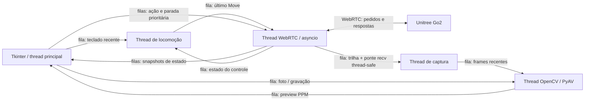

# Go2 — câmera e teleoperação via WebRTC

Aplicação Python para visualizar a câmera do **Unitree Go2**, salvar fotos JPG,
gravar vídeos MP4/H.264 e enviar comandos de postura e locomoção pelo Wi-Fi
local. Mantém Tkinter, OpenCV, PyAV/aiortc, todas as teclas e as entradas
históricas, com workers separados e logs correlacionados usando **Loguru**.

## Pré-requisitos

- Python **3.12**, indicado em `.python-version`.
- Linux com sessão gráfica e Tkinter.
- `uv` para instalar, executar e gerenciar as dependências Python.
- Na máquina que controla o robô: Go2 acessível pelo Wi-Fi AP, em `192.168.12.1`.
- PortAudio para as dependências de áudio do driver, mesmo usando apenas vídeo.
- Encoder `libx264` na instalação do PyAV.

Para executar a interface e o driver na máquina de controle, instale os
pré-requisitos de sistema. Em Ubuntu/Debian:

```bash
sudo apt update
sudo apt install python3-tk python3-dev portaudio19-dev build-essential libgl1 libglib2.0-0
```

Use os pacotes correspondentes ao seu Python. Tkinter e PortAudio são
pré-requisitos nativos e não são gerenciados pelo `uv`.

## Instalação

Instale o `uv` conforme a [documentação oficial](https://docs.astral.sh/uv/getting-started/installation/).
Na raiz do repositório:

```bash
uv sync --locked
uv pip check
```

`uv sync --locked` cria `.venv` e instala o projeto editável com as versões
registradas em **`uv.lock`**, incluindo dependências transitivas e hashes.
O Python 3.12 é selecionado por `.python-version`; o `uv` pode baixá-lo se
necessário. Não é preciso criar ou ativar o ambiente manualmente.

`pyproject.toml` define as dependências diretas. **Loguru 0.7.3 é obrigatório**.
`uv.lock` deve ser versionado junto com `pyproject.toml`. O extra vazio
`observability` permanece como alias de compatibilidade. `requirements.txt`
foi substituído pelo fluxo de projeto do `uv`.

## Gerenciamento de dependências

```bash
uv add nome-do-pacote          # adiciona uma dependência
uv add --dev nome-do-pacote    # adiciona uma ferramenta de desenvolvimento
uv remove nome-do-pacote      # remove uma dependência
uv lock                      # atualiza o lock após editar pyproject.toml
uv lock --check               # verifica se o lock está atualizado
uv sync --locked              # sincroniza o ambiente com o lock versionado
uv tree --locked              # exibe a árvore de dependências
```

`uv add` e `uv remove` atualizam a declaração, o lock e o ambiente. Para
atualizar dependências transitivas compatíveis, use `uv lock --upgrade` e
depois `uv sync --locked`. As versões diretas estão fixadas com `==`; para
alterá-las, use `uv add 'nome-do-pacote==nova-versao'`. Revise o diff do lock
e execute os testes antes de versionar a atualização.

Neste workspace, os pré-requisitos nativos ausentes foram extraídos em
`.venv/system`, sem modificar o sistema. Para usar esse ambiente preparado:

```bash
source .venv/env-local.sh
```

Esse script local configura as bibliotecas de Tk/PortAudio e ALSA. Ele não
substitui `uv sync` nem faz parte da instalação em outra máquina. A presença
do robô não é necessária para sincronizar dependências ou executar os testes.

## Execução e configuração

Na máquina de controle, conecte ao Wi-Fi AP do robô antes de executar:

```bash
uv run --locked go2-env --nivel-log DEBUG
# Entradas equivalentes:
uv run --locked python -m go2_env
uv run --locked python foto_webrtc/teste_video.py
```

Os mesmos comandos estão disponíveis pelo `Makefile`:

```bash
make install
make run
make run ARGS="--nivel-log DEBUG"
make window
make diagnostico
```

`make diagnostico` conecta ao Go2 e consulta o modo atual e o estado informado
pela API (`state`, `bodyHeight`, `speedLevel`, `gait`), lê uma amostra de
`LowState` com temperaturas dos motores e resume as falhas ativas; não envia
comandos de postura nem de movimento. Compartilhe a saída completa para
investigar falhas de comunicação da API.

Teste apenas a interface, sem conexão ou comandos:

```bash
uv run --locked go2-env --testar-janela
```

A execução normal também mantém a interface aberta quando o Go2 está
inacessível. A conexão exibe **Conectando**, **Conectado**, **Desconectado** ou
**Erro**. Em modo offline, confira o Wi-Fi/robô e pressione **F5** ou clique em
**Reconectar**. O botão fica desabilitado durante a conexão e enquanto conectado;
pedidos repetidos não criam novas threads nem tentativas simultâneas.

Cada reconexão usa um transporte novo na mesma thread `go2-rtc` e no mesmo loop
asyncio. Leituras de vídeo e comandos da sessão anterior são cancelados ou
descartados. Os comandos do robô ficam bloqueados sem conexão válida, e após
reconectar é necessário **U/R** aceito para liberar a locomoção. Não há retry
automático nem retomada de movimentos antigos.

Falhas de rede, timeout e sinalização (incluindo `LocalSignalingPortError`)
são recuperáveis e registradas no Loguru como `connection_recoverable`, com
tipo de erro e número da tentativa. Bugs, dependências ausentes e outros erros
críticos mantêm o encerramento coordenado e o diagnóstico `Falha nas threads`.

Consulte todas as opções com `uv run --locked go2-env --help`. Exemplo:

```bash
uv run --locked go2-env --pasta-logs logs --pasta-saida capturas_go2 --timeout-pedido 5 --publicar-hz 20
```

O padrão de captura permanece `foto_webrtc/capturas_go2/fotos/` e
`foto_webrtc/capturas_go2/videos/`. Os logs ficam em `logs/`, relativos ao
diretório de execução. Caminhos personalizados são definidos pelas opções acima.

Os ajustes imutáveis ficam em `foto_webrtc/config.py` (`Config`). As constantes
históricas de `teste_video.py` ainda definem os ganhos, atrasos de postura e
padrões usados pela CLI.

| Ajuste | Padrão | Uso |
| --- | --- | --- |
| `linear_gain` | `0.3` | Velocidade linear, m/s |
| `angular_gain` | `0.5` | Velocidade angular, rad/s |
| `publish_hz` | `20.0` | Cadência máxima dos comandos Move |
| `request_timeout` | `5.0 s` | Prazo para resposta da API |
| `connect_timeout` | `30.0 s` | Prazo da conexão WebRTC |
| `disconnect_timeout` | `5.0 s` | Prazo da desconexão |
| `input_timeout` | `0.3 s` | Watchdog do heartbeat do teclado |
| `frame_timeout` | `2.0 s` | Validade de frames para foto/gravação |
| `shutdown_timeout` | `10.0 s` | Prazo antes de reportar encerramento lento |

Firmware que exige AES pode usar a variável **`UNITREE_AES_128_KEY`**. A chave
é passada ao driver sem ser registrada como configuração nos logs. Confira a
[documentação de autenticação do driver](https://github.com/legion1581/unitree_webrtc_connect#readme).
Não coloque chaves no código. O programa não carrega `.env` automaticamente.

## Controle

Clique na janela para dar foco ao teclado. Clique em **Levantar** ou pressione
**U** e aguarde o indicador **PRONTO PARA ANDAR** antes de locomover.
Código zero é aceitação pela API; observe a estabilidade
física do robô antes de andar.

A câmera ocupa uma área independente dos controles. O frame fica centralizado
e se ajusta ao espaço disponível, preservando a proporção e todas as bordas.
Ao maximizar ou reduzir a janela, a prévia acompanha o tamanho; fotos e MP4
mantêm a resolução original. Conexão, permissão de locomoção e captura aparecem
em áreas separadas. Os botões de postura ficam desabilitados durante uma ação.

| Tecla | Ação |
| --- | --- |
| ↑ / ↓ ou W / S | Frente / trás enquanto segura |
| ← / → ou Q / E | Virar à esquerda / direita enquanto segura |
| A / D | Deslocamento lateral enquanto segura |
| Espaço | Parar |
| U / J / R | Levantar / deitar / recuperar |
| B / botão Equilibrar | BalanceStand: preparar equilíbrio |
| H / K | Aceno / amortecer juntas |
| M | Consultar modo de movimento |
| P | Salvar foto JPG |
| V | Iniciar ou finalizar MP4 |
| F5 / botão Reconectar | Tentar conectar novamente em modo offline |
| Esc | Parar, finalizar gravação e encerrar |

Para virar no lugar, segure **←/→**, **Q/E** ou um dos botões **Virar** na
interface. Para fazer uma curva andando, combine **↑** com **←** ou **→**.
O controle **Velocidade do giro** ajusta a rotação entre 0,10 e 1,00, com
padrão 0,50, tanto no teclado quanto nos botões. Soltar o botão ou tirar o
ponteiro de cima dele encerra o giro solicitado pelo mouse. Os botões de giro
só ficam disponíveis em **PRONTO PARA ANDAR**.

Soltar as teclas, perder o foco ou perder o heartbeat da GUI solicita velocidade
zero. Posturas suspendem a locomoção enquanto estão em andamento; depois de
J/K, é necessário U/R aceito para liberá-la. Outra ação durante uma postura é
rejeitada antes de entrar na fila, sem gerar outra parada. A soltura das teclas
usa uma margem de 40 ms para filtrar os eventos de repetição do teclado no X11.
Não há repetição automática de posturas ou reconexão
que retome movimentos anteriores. Espaço interrompe a velocidade; não cancela
uma postura que já foi aceita pelo robô.

Os modos `normal` e `mcf` são aceitos. Em `mcf`, o programa usa a tabela
`SPORT_CMD_MCF` do driver e mantém esse modo, sem forçar uma troca para `normal`.
Após U/R aceito em `mcf`, aguarda a postura e solicita `BalanceStand` (1002 no
tópico sport). A locomoção só é liberada quando essa etapa também é aceita.
O botão **Equilibrar (B)** permite solicitar essa etapa separadamente, sem
repetir Levantar. A sequência após StandUp segue a
[orientação do driver](https://github.com/legion1581/unitree_webrtc_connect/blob/master/examples/go2/data_channel/sportmode_mcf/sportmode_mcf.py).
A consulta de modo não libera a locomoção. Código zero continua sendo
aceitação da API e não comprova que o robô tenha ficado em pé. Se a API aceita
e o robô continua deitado, encerre a interface e compartilhe a saída atual de
`make diagnostico`, incluindo a consulta de estado.

Falhas recebidas em `errors`, `add_error` e `rm_error` são acompanhadas desde
a sinalização, antes de `connect()` concluir. Assim os alertas iniciais de
motor não se perdem. Falhas de motor (fontes 300–399) e de proteção de movimento
(600) exibem **FALHA ATIVA NO ROBÔ**, bloqueiam novas posturas e velocidades,
e mantêm a consulta de modo disponível. Uma falha removida não retoma movimentos:
é necessário um novo comando explícito de postura. Os códigos são exibidos com
fonte e valor hexadecimal, preservando os dados do firmware.

Se aparecerem erros como `306-10` e `309-4`, verifique os alarmes e as
temperaturas no Unitree Go; não continue repetindo posturas para tentar limpar
uma proteção. `GetState` com payload vazio não confirma estado nem temperatura.
O diagnóstico tenta obter temperaturas por `LowState` durante até 3 segundos
e informa explicitamente quando não recebe telemetria.

A parada depende do programa e da conexão; não substitui uma parada física de
emergência. Falha, rejeição ou timeout de um Move ativo suspende a locomoção,
invalida comandos antigos e solicita zero. Respostas tardias ficam nos logs e
não reativam o controle.

## Arquitetura e padrões

| Componente | Thread | Responsabilidade |
| --- | --- | --- |
| `JanelaCamera` | principal | Tkinter, teclado e exibição de PPM já processado |
| `LocomotionWorker` | `go2-locomotion` | Converte snapshots do teclado em velocidades na cadência configurada |
| `RobotWorker` | `go2-rtc` | Event loop asyncio exclusivo, estado de postura e envio serializado ao driver |
| `CaptureWorker` | `go2-capture` | Aguarda frames pela ponte thread-safe do loop RTC; entrega frames sem processamento |
| `VideoProcessor` | `go2-video` | OpenCV, redimensionamento, JPG e codificação/finalização MP4 |
| coordenador de saída | `go2-shutdown` | Aguarda workers sem executar `join()` em callbacks Tk |



- **Command:** mensagens imutáveis com IDs e parâmetros, sem acesso a widgets.
- **Adapter:** `RobotTransport` permite substituir o WebRTC por um transporte
  simulado nos testes. `WebRTCTransport` encapsula o protocolo e a correlação.
- **Producer/Consumer:** filas `queue.Queue` limitadas e operações sem bloqueio
  nos produtores. Teclado, preview e velocidade usam o item mais recente;
  ações discretas usam FIFO e rejeição explícita quando a fila está cheia.
- **Estado explícito:** snapshots imutáveis de conexão, modo, postura e permissão para
  locomover. Somente `RobotWorker` altera o estado do robô.
- **Facade:** `Application` conecta componentes e coordena início e encerramento.
- **Template Method:** `Worker.run()` padroniza logs e exceções; cada componente
  implementa sua tarefa em `work()`.

O driver, o canal SCTP e `track.recv()` pertencem ao loop da thread RTC.
A captura usa `asyncio.run_coroutine_threadsafe`; não compartilha objetos
aiortc entre event loops. Conversão de imagem, escrita de fotos e encoding não
ocorrem na GUI nem no loop RTC. O handshake HTTP bloqueante usa um executor
separado, com timeouts de conexão/leitura e sem proxies para o IP local.

Frames e velocidades antigos são descartados para limitar memória e latência.
Uma geração no mailbox invalida movimentos pendentes ao parar ou solicitar
postura; o lock protege a validação junto com o envio. A fila de parada é
prioritária e não depende de espaço na fila de ações.

## Observabilidade e diagnóstico de movimento

O console mostra ações e falhas; os arquivos **JSONL** mantêm DEBUG, incluindo
cada Move enviado e sua resposta. Os sinks do Loguru usam `enqueue=True`,
rotação de **10 MB**, retenção de **14 dias** e `diagnose=False`. As mensagens
pendentes são drenadas com `logger.complete()` antes de fechar os sinks, conforme
[a API do Loguru](https://loguru.readthedocs.io/en/stable/api/logger.html).
Falhas das bibliotecas via `logging` e avisos `errors/add_error/rm_error` do
robô também entram no arquivo.

Os campos ficam em `record.extra`:

| Campo | Significado |
| --- | --- |
| `session_id`, `component`, `event` | Sessão, componente e etapa do fluxo |
| `command_id`, `parent_command_id` | Comando e vínculo de consultas/paradas auxiliares com a ação |
| `request_id`, `topic`, `api_id` | Identidade usada no protocolo WebRTC |
| `parameters` | Parâmetros reais enviados, como `x/y/z` |
| `queue_ms` | Tempo entre criação e envio |
| `duration_ms` | Tempo desde o envio até resposta/timeout/cancelamento |
| `status`, `response` | Resultado e envelope de resposta recebido |

`duration_ms` mede a espera da API, **não a duração física do movimento**.
`accepted` significa resposta com código zero, sem comprovar deslocamento.
`rejected`, `malformed`, `timeout`, `late_response` e `send_failed` distinguem as
falhas. Pedidos restantes são registrados como `cancelled` ao desconectar;
`superseded` indica substituição no limite do registro pendente.

Para o problema de falta de movimento:

1. Confira `connected` e eventuais exceções de autenticação/conexão. Compare
   `driver_version`, estado do canal, API e tópico registrados.
2. Pressione **M** e confira `robot_state.mode` e o modo exibido na janela.
   `normal` e `mcf` permitem comandos de postura; `mcf` é preservado. Para
   outros modos, U/R consulta e solicita `normal` antes da postura, espera
   uma margem de 5 segundos e consulta novamente para confirmar a troca.
3. Se aparece `movement_inhibited`, confira `connected`, `busy`, `mode` e a
   mensagem de estado; o comando não foi enviado porque o controle está suspenso.
   `movement_started` no console registra o início de uma solicitação de
   velocidade pelo teclado. Se apenas Move com `x/y/z` iguais a zero foi
   enviado, o robô recebeu paradas, sem solicitação de deslocamento.
4. Filtre `command_sent` e `command_result` pelo mesmo `command_id/request_id`.
   Em `timeout`, o programa não reconheceu uma resposta válida no prazo: a ação
   pode ter chegado ao robô. Em `rejected`, inspecione o código em `response`
   e os `robot_error`. O tópico de resposta (`response_topic`) termina em
   `/response`, enquanto o envio (`topic`) termina em `/request`; o adapter
   valida essa correspondência junto com o ID do pedido e a API.
5. Se Move aparece como `accepted`, mas o robô não anda, os logs confirmam a
   resposta da API. Investigue postura real, modo/firmware e outros clientes de
   controle; não conclua que houve deslocamento somente pelo código zero.

O registro pendente do adapter é limitado a **256** pedidos e guarda até **64**
pedidos expirados para reconhecer respostas tardias. Move usa o envelope de
requisição do driver, com IDs únicos, mas não cria Futures no resolver do SDK.
Isso evita acumulação e `InvalidStateError` quando respostas chegam depois de
um timeout. O listener adicional preserva o processamento normal do driver.
O buffer SCTP também é verificado antes de enviar velocidades não nulas.

## Captura e encerramento

MP4 mantém a resolução do stream, sem áudio, com linha do tempo iniciada em
zero e precisão de 1/30 s. Frames acima de 30 fps são amostrados; lacunas de
tempo são preservadas quando frames são descartados. O indicador REC aparece
somente no preview. É possível tirar foto durante uma gravação.

Ao fechar, pressionar Esc ou receber SIGINT/SIGTERM, a aplicação marca o Event
de encerramento, cancela ações assíncronas, tenta enviar zero, fecha o MP4 com
flush do encoder, desliga vídeo e desconecta. Os workers não são daemon e são
aguardados antes de destruir o Tk e drenar os logs. Exceções em workers ou
callbacks da interface provocam a mesma parada coordenada.

Se um recurso nativo demorar além do prazo de saída, a GUI informa a demora e
os logs listam as threads pendentes. Python não pode matar uma thread presa
em I/O nativo com segurança; a aplicação aguarda seu retorno. Encerrar o
processo à força pode impedir o fechamento do MP4 e o envio de parada.

## Estrutura

```text
foto_webrtc/
├── teste_video.py      # CLI e constantes históricas
├── application.py      # Facade e ciclo de vida
├── gui.py              # View Tkinter
├── config.py           # configuração imutável
├── models.py           # mensagens Command e snapshots
├── channels.py         # filas, prioridade e invalidação
├── commands.py         # worker de locomoção e watchdog
├── robot.py            # estado e worker RTC
├── transport.py        # Adapter WebRTC e respostas correlacionadas
├── signaling.py        # handshake HTTP com timeout
├── video.py            # captura, OpenCV, JPG e MP4
├── workers.py          # ciclo de vida comum das threads
├── observability.py    # Loguru, JSONL e logs de bibliotecas
├── foto_webrtc.py      # exemplo histórico de fotos
├── correcao_imagem.py  # exemplo histórico de fisheye
├── teste.py            # teleoperação anterior
└── testemov.py         # demonstração com movimentos automáticos
src/go2_env/            # go2-env e python -m go2_env
tests/                  # protocolo, concorrência, GUI, vídeo, logs e CLI
pyproject.toml          # declaração de dependências e empacotamento
uv.lock                 # resolução versionada das dependências
.python-version         # Python usado pelo uv
```

Os exemplos históricos continuam disponíveis. `testemov.py` move o robô
automaticamente; não faz parte da suíte de testes nem usa a nova arquitetura.

## Validação

```bash
uv lock --check
uv sync --locked --check
uv run --locked python -m unittest discover -s tests -v
uv run --locked python -m compileall -q src foto_webrtc tests
uv run --locked go2-env --help
uv pip check
```

Os testes usam transportes simulados e frames sintéticos. Testam rejeições,
timeouts/respostas tardias, prioridade de parada, watchdog, afinidade de
threads, falhas, encerramento, logs e arquivos JPG/MP4 reais. Os testes de GUI
requerem Tkinter e `DISPLAY` e são ignorados quando não há sessão gráfica.
Podem ser executados com um display virtual instalado:

```bash
xvfb-run -a uv run --locked python -m unittest discover -s tests -v
```

Nenhum teste da suíte conecta ao Go2 ou comprova locomoção física. Em campo,
observe as respostas de M/U antes de andar, faça movimentos breves e confira
os registros. Valide fotos, MP4 e saída com Esc durante uma gravação.

## Versionamento

`.gitignore` exclui ambientes virtuais, configuração privada, logs e capturas.
Revise `git status` e `git diff` antes de publicar. Não force a inclusão de dados
privados. Esta implementação não configura remote, cria commit ou executa push.
