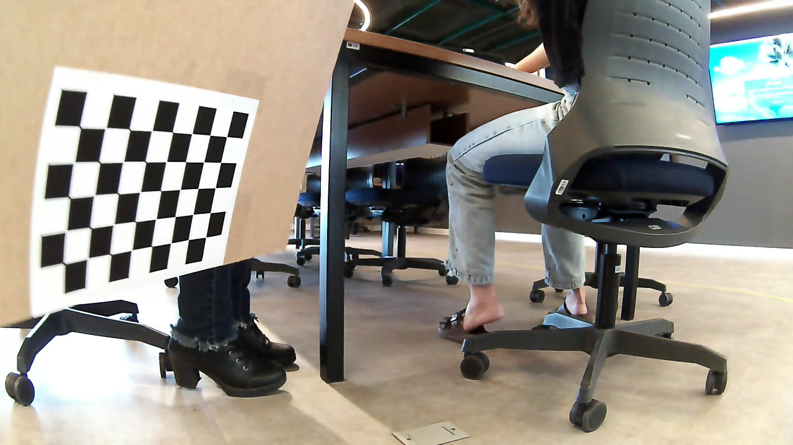
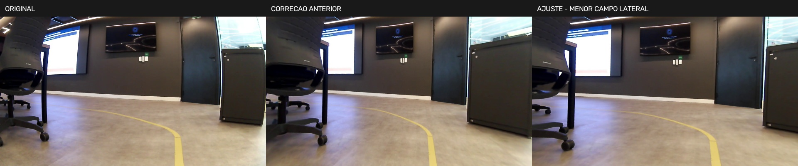
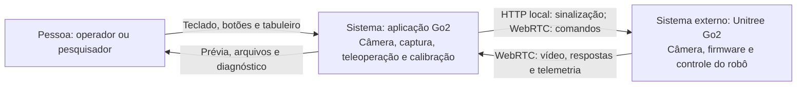
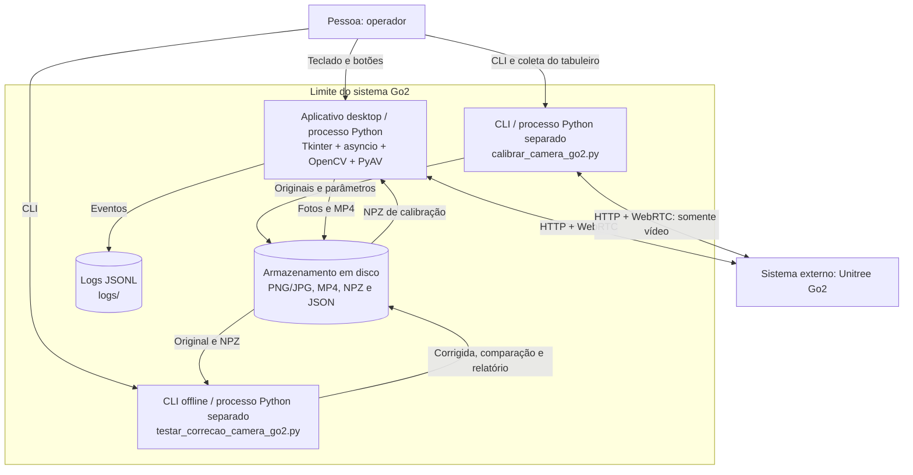
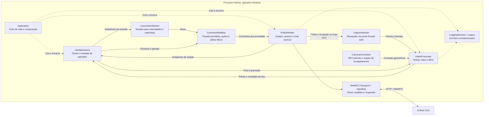
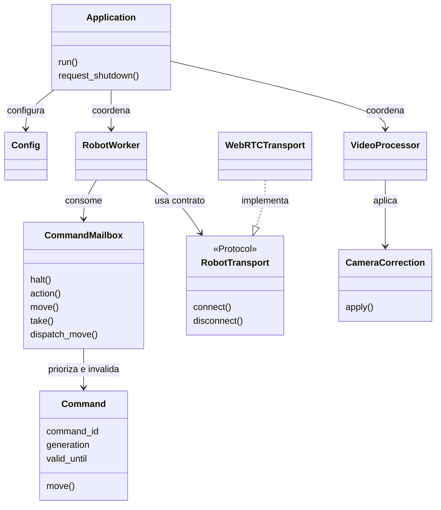
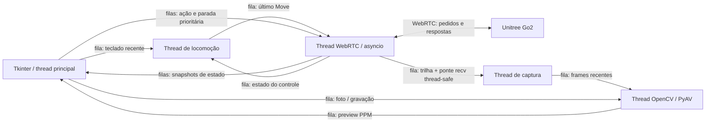

# Guia técnico — Go2

[← Voltar ao README](../README.md)

Detalhes de calibração, arquitetura, diagnóstico e histórico de instalação.
Os comandos devem ser executados na **raiz do projeto**, mesmo quando lidos neste guia.

## Do terminal inicial ao projeto atual

### Comandos iniciais organizados

O bloco abaixo reconstrói a preparação inicial em uma ordem executável, para
consulta histórica. Para instalar a versão atual, use a seção
[Instalação](../README.md#instalação), com as versões do `uv.lock`.

```bash
# Primeiro, ferramentas do sistema; Git deve existir antes de git clone.
sudo apt update
sudo apt install -y git python3-pip python3-venv portaudio19-dev

# Estrutura usada no início do projeto.
mkdir -p ~/go2_env/foto_webrtc
python3 -m venv ~/go2_env
source ~/go2_env/bin/activate
cd ~/go2_env/foto_webrtc

python -m pip install --upgrade pip
python -m pip install unitree_webrtc_connect opencv-python aiortc numpy
```

Nesse formato antigo, **`~/go2_env` era ao mesmo tempo pasta do projeto e
ambiente virtual**: `bin/`, `lib/` e `pyvenv.cfg` ficavam ao lado dos scripts.
Isso explica a estrutura local, mas dificulta distinguir código de dependências.
Hoje, o código fica na raiz do repositório e o ambiente isolado fica em
**`.venv/`**, criado pelo `uv`. Os comandos históricos sem versões não garantem
recriar as mesmas dependências instaladas naquela época.

O clone do SDK oficial pode ser mantido separadamente para estudo:

```bash
cd ~
git clone https://github.com/unitreerobotics/unitree_sdk2_python.git
```

Esse comando apenas baixa o SDK. Não é necessário instalar suas dependências
para executar o projeto WebRTC. A
[issue #17 do ProIC-2026](https://github.com/laismedeiros19/ProIC-2026/issues/17)
registra o comando de clone no título, sem descrição ou procedimento adicional.

Nos exemplos deste README, copie somente os comandos dentro dos blocos `bash`.
O texto `idealab@...:~$` é o prompt do terminal, e um endereço de issue é uma
referência para abrir no navegador; não é um comando. Links em comandos devem
ser URLs simples, sem a marcação Markdown `[texto](../url)`.

## Configuração da aplicação

Os valores ficam em `foto_webrtc/config.py`; a CLI usa os padrões definidos em
`foto_webrtc/teste_video.py`. Consulte `uv run --locked go2-env --help`.

| Ajuste | Padrão | Uso |
| --- | --- | --- |
| `linear_gain` | `0.5` | Velocidade linear, m/s |
| `angular_gain` | `0.5` | Velocidade angular, rad/s |
| `publish_hz` | `20.0` | Cadência máxima dos comandos Move |
| `request_timeout` | `5.0 s` | Prazo para resposta da API |
| `connect_timeout` | `30.0 s` | Prazo da conexão WebRTC |
| `disconnect_timeout` | `5.0 s` | Prazo da desconexão |
| `input_timeout` | `0.3 s` | Watchdog do heartbeat do teclado |
| `frame_timeout` | `2.0 s` | Validade de frames para foto/gravação |
| `shutdown_timeout` | `10.0 s` | Prazo antes de reportar encerramento lento |

```bash
uv run --locked go2-env --pasta-logs logs --pasta-saida capturas_go2 --timeout-pedido 5 --publicar-hz 20
```

## Gerenciamento de dependências

```bash
uv add nome-do-pacote          # adiciona uma dependência
uv add --dev nome-do-pacote    # adiciona uma ferramenta de desenvolvimento
uv remove nome-do-pacote      # remove uma dependência
uv lock                      # atualiza o lock após editar pyproject.toml
uv lock --check               # verifica se o lock está atualizado
uv sync --locked              # sincroniza o ambiente com o lock versionado
uv tree --locked              # exibe a árvore de dependências
```

`uv add` e `uv remove` atualizam a declaração, o lock e o ambiente. Para
atualizar dependências transitivas compatíveis, use `uv lock --upgrade` e
depois `uv sync --locked`. As versões diretas estão fixadas com `==`; para
alterá-las, use `uv add 'nome-do-pacote==nova-versao'`. Revise o diff do lock
e execute os testes antes de versionar a atualização.

Uma versão anterior deste README mencionava `.venv/env-local.sh` e bibliotecas
extraídas em `.venv/system`. Esse script não está presente no checkout
inspecionado. Use os pacotes de sistema descritos acima; não dependa desse
arquivo local para reproduzir a instalação. A presença do robô não é necessária
para sincronizar dependências ou executar os testes.

## Calibração e correção de imagens

### Do experimento inicial aos parâmetros medidos

O script histórico `correcao_imagem.py` combina uma tentativa de correção
fisheye com sharpening e CLAHE. Ele define `fx = fy = 360` e
`D = [-0.05, 0.01, -0.005, 0.0002]` diretamente no código. Esses valores são
experimentais: **não são o resultado de uma calibração da câmera**. Nitidez e
contraste alteram a aparência, mas não estimam a geometria da lente.

O fluxo atual usa imagens do próprio Go2 com um tabuleiro, detecta seus cantos e
estima `K` (matriz intrínseca) e `D` (coeficientes de distorção). O calibrador
oferece `pinhole` e `fisheye`; a aplicação e o teste de correção aceitam atualmente
**somente pinhole com cinco coeficientes**. Os modelos têm convenções distintas;
os coeficientes não podem ser intercambiados. Consulte a
[calibração do OpenCV](https://docs.opencv.org/4.x/dc/dbb/tutorial_py_calibration.html)
e o [modelo fisheye](https://docs.opencv.org/4.x/db/d58/group__calib3d__fisheye.html).

### 1. Preparar o tabuleiro

O código atual define `BOARD = (5, 8)`: **5 colunas × 8 linhas de cantos
internos**, totalizando 40 pontos, em um tabuleiro de **6 × 9 quadrados**.
Conte as interseções internas, não os quadrados. O documento antigo
`docs/prompt_calibracao_camera_go2.md` menciona outro padrão e uma interface
planejada com subcomandos; ele não descreve a implementação final. A referência
executável é `calibrar_camera_go2.py --help` e a constante `BOARD` do script.

Meça o lado real de um quadrado em milímetros. O valor configurado e registrado
na sessão existente é `30.0 mm`; isso não substitui medir outro tabuleiro.
Para outro padrão, ajuste `BOARD` no script antes da coleta; não existem opções
`--colunas` e `--linhas` nesta CLI. Fixe o papel em uma base plana e rígida.



A imagem acima é uma cópia da vista 070 da coleta de 21/10/2026. Ela também
participou do ajuste e serve para ilustrar o procedimento, sem constituir
validação independente.

### 2. Coletar imagens com o Go2 parado

Conecte o computador ao Wi-Fi AP do robô e encerre outras sessões da câmera.
Informe a medida real; o exemplo abaixo solicita esse valor antes de executar:

```bash
read -r -p "Lado medido de um quadrado, em mm: " QUADRADO_MEDIDO_MM
uv run --locked python calibrar_camera_go2.py \
  --conexao ap --modelo pinhole --quadrado-mm "$QUADRADO_MEDIDO_MM"
```

Essa ferramenta abre uma conexão dedicada ao vídeo, sem carregar a aplicação de
teleoperação nem publicar comandos de locomoção ou postura. Mova manualmente o
tabuleiro. Ela também oferece `--conexao sta --ip IP_DO_ROBO` para uma rede local
com o robô em modo STA; a aplicação principal está configurada para LocalAP.

| Tecla na janela de calibração | Ação |
| --- | --- |
| Espaço | Salva PNG original e tenta detectar os cantos |
| C | Calcula a calibração com as vistas válidas |
| U | Remove a última foto desta coleta, inclusive o arquivo PNG |
| Q / Esc | Encerra sem calcular; preserva as fotos restantes |

O mínimo operacional implementado é **10 vistas válidas**. Procure obter
**20–30 vistas variadas**, com o tabuleiro inteiro em diferentes distâncias,
inclinações e posições, incluindo bordas e cantos. A contagem mínima não
garante boa calibração. Fotos sem os 40 cantos ou quase repetidas são salvas,
mas não entram no ajuste. A tecla C exige a quantidade mínima de vistas aceitas.

Os PNGs preservam o frame decodificado do WebRTC, sem desenhos, correção,
recorte ou redimensionamento local. Eles não são RAW do sensor: o robô já pode
ter processado e comprimido o vídeo antes de transmiti-lo.

Cada execução cria uma pasta em `calibracoes_go2/`. Uma coleta interrompida
pode conter apenas `sessao.json`; isso não indica calibração concluída. Após C
e um ajuste válido, são produzidos `calibracao.npz` e `calibracao.json`.

### 3. Recalibrar as fotos offline

Com as imagens disponíveis, não é preciso ligar o robô ou abrir uma janela:

```bash
read -r -p "Lado medido de um quadrado, em mm: " QUADRADO_MEDIDO_MM
uv run --locked python calibrar_camera_go2.py \
  --imagens "fotos/fotos tabuleiro" \
  --prefixo calibracao_20261021_093812_illc3whs_ \
  --modelo pinhole --quadrado-mm "$QUADRADO_MEDIDO_MM"
```

Use o prefixo da sua própria sessão para outra coleta. A leitura da pasta não
é recursiva; as saídas em subpastas não são incluídas automaticamente.
Imagens ilegíveis, sem detecção ou quase duplicadas são informadas no terminal.
Resoluções incompatíveis com as vistas aceitas interrompem o ajuste.

O JSON registra modelo, resolução, padrão, medida do quadrado, versões,
`K`, `D`, RMS global, erros por vista, arquivos usados e poses do tabuleiro.
As translações são salvas em **milímetros**, em `tvecs_mm`, conforme a escala
usada no código. Essas poses não são a transformação câmera-corpo do robô.

### 4. Resultado disponível neste workspace

Fonte: [relatório da calibração de 21/10](../calibracoes_go2/20261021_180527_uaywafbe/calibracao.json).

| Propriedade | Resultado registrado |
| --- | --- |
| Modelo | pinhole, cinco coeficientes |
| Resolução | 1280 × 720 pixels |
| Vistas usadas | 75 |
| Padrão | 5 × 8 cantos internos |
| Lado do quadrado registrado | 30 mm |
| RMS de reprojeção nas vistas de ajuste | aproximadamente 0,569114 px |

```text
K ≈ [[807.503927,   0.000000, 629.345567],
     [  0.000000, 804.523639, 348.165335],
     [  0.000000,   0.000000,   1.000000]]

D ≈ [-0.378174518, 0.157404275, -0.000746961, -0.000362531, -0.034354368]
     [k1,           k2,           p1,            p2,            k3]
```

Os valores acima estão arredondados para leitura; use o NPZ para processamento.
O RMS mede a distância de reprojeção nos cantos usados no ajuste, em pixels.
Ele não é uma medida de erro físico do robô nem garante bordas retas em toda
a imagem. A revisão encontrou apenas **45 de 3.000 cantos (1,5%)** na faixa
externa de 10% da imagem. Isso limita a evidência sobre a correção das bordas.

### 5. Testar uma foto e entender o ajuste de enquadramento

Para a vista de exemplo, se o conjunto de fotos estiver disponível:

```bash
uv run --locked python testar_correcao_camera_go2.py \
  --imagem "fotos/fotos tabuleiro/calibracao_20261021_093812_illc3whs_vista_070.png" \
  --calibracao calibracoes_go2/20261021_180527_uaywafbe/calibracao.npz \
  --alpha 0
```

Para testar uma imagem nova, substitua `--imagem` por um original do mesmo
stream e da mesma resolução. Acrescente `--mostrar` para abrir a comparação
quando houver sessão gráfica. Sem essa opção, o comando apenas salva arquivos.
`relatorio.json` registra a saída e se a foto foi usada no ajuste. O teste
baseia essa identificação nos caminhos salvos; ao mover o conjunto para outra
máquina, confira também o nome/origem da foto, pois os caminhos podem mudar.

A correção usa `getOptimalNewCameraMatrix`, `initUndistortRectifyMap` e `remap`.
Na revisão do enquadramento, foi acrescentado `centerPrincipalPoint=True` para
preservar a relação focal `fx/fy` na saída. A versão anterior gerava escalas
relativas diferentes nos dois eixos, aproximadamente 0,709 e 0,918. O ajuste
passou a usar aproximadamente 0,956 em ambos, reduzindo o campo lateral.
Os parâmetros medidos `K/D` foram mantidos.



Da esquerda para a direita: original, correção anterior e ajuste com menor
campo lateral. A faixa amarela tem uma curva física; não é uma referência
segura para exigir retidão. Compare portas, paredes e outras linhas retas
conhecidas, principalmente em fotos novas. A imagem ilustra a mudança de
proporção/enquadramento e não comprova eliminação de toda distorção.
O [relatório da revisão](../testes_correcao_go2/revisao_bordas_t5n8p55k/relatorio.json)
registra a comparação, a cobertura e os experimentos de modelos que não foram
promovidos à configuração da aplicação.

`alpha=0` é o padrão e reduz o campo de visão; `alpha=1` tenta preservar mais
campo, mas apresentou deformações fortes nas extremidades neste conjunto.
O programa mantém 1280×720 na saída e não recorta posteriormente a ROI.
Não aplique outra correção a uma foto já corrigida.

### 6. Aplicar uma calibração na interface

```bash
# Substitua o caminho pela nova pasta criada pelo calibrador.
uv run --locked go2-env --calibracao CAMINHO_DA_SESSAO/calibracao.npz

# Receber e salvar o stream sem correção local.
uv run --locked go2-env --sem-correcao
```

O primeiro exemplo contém um caminho a substituir; não existe uma pasta chamada
`CAMINHO_DA_SESSAO` no projeto. O padrão atual já aponta para a sessão de 21/10.
Se esse NPZ não acompanhar a cópia do repositório, use `--sem-correcao` ou forneça
uma calibração pinhole válida. A correção é aplicada uma vez antes das saídas,
com mapas reutilizados, e o redimensionamento da prévia vem depois.

## Arquitetura C4

O [modelo C4](https://c4model.com/diagrams) descreve um sistema em níveis de
contexto, contêineres, componentes e código. Os diagramas abaixo usam Mermaid,
renderizado pelo GitHub, para representar esses níveis. As threads são detalhes
internos do processo Python, e não contêineres independentes.

### C1 — Contexto do sistema

O operador usa o aplicativo no computador conectado à rede do Go2. O robô é um
sistema externo, com câmera, firmware e APIs próprios. A execução LocalAP aqui
implementada não depende de um servidor na nuvem.



### C2 — Contêineres e armazenamento

Há um aplicativo desktop Python e ferramentas Python executadas separadamente
por CLI. O calibrador usa uma conexão própria somente de vídeo ou trabalha
offline. O teste de correção lê arquivos e não se conecta ao Go2. Não há banco
de dados: a persistência é feita no sistema de arquivos.



Não abra o calibrador e a teleoperação simultaneamente para disputar a câmera.
Os processos do diagrama representam modos de uso separados; não é necessário
manter todos em execução.

### C3 — Componentes da aplicação desktop

`Application` conecta a interface, os workers e as filas. `RobotWorker` é o dono
do loop RTC e do estado de controle; `WebRTCTransport` encapsula o driver.
A interface recebe resultados por filas e não acessa o driver diretamente.



A tabela de threads e o fluxo de filas da próxima seção detalham como esses
componentes dividem o trabalho. A composição real está em `application.py`.

### C4 — Código e contratos principais

O quarto nível aproxima o diagrama das classes reais, sem listar todos os
métodos. `RobotTransport` é um `Protocol`; permite que os testes forneçam um
transporte simulado. As setas de dependência abaixo representam uso ou
implementação do contrato, não processos separados.



Os arquivos `models.py`, `channels.py`, `robot.py`, `transport.py` e
`calibration.py` são as referências para esses contratos. Os testes de
concorrência, transporte, vídeo e calibração verificam suas relações.

## Arquitetura e padrões

| Componente | Thread | Responsabilidade |
| --- | --- | --- |
| `JanelaCamera` | principal | Tkinter, teclado e exibição de PPM já processado |
| `LocomotionWorker` | `go2-locomotion` | Converte snapshots do teclado em velocidades na cadência configurada |
| `RobotWorker` | `go2-rtc` | Event loop asyncio exclusivo, estado de postura e envio serializado ao driver |
| `CaptureWorker` | `go2-capture` | Aguarda frames pela ponte thread-safe do loop RTC; entrega frames sem processamento |
| `VideoProcessor` | `go2-video` | OpenCV, redimensionamento, JPG e codificação/finalização MP4 |
| coordenador de saída | `go2-shutdown` | Aguarda workers sem executar `join()` em callbacks Tk |



- **Command:** mensagens imutáveis com IDs e parâmetros, sem acesso a widgets.
- **Adapter:** `RobotTransport` permite substituir o WebRTC por um transporte
  simulado nos testes. `WebRTCTransport` encapsula o protocolo e a correlação.
- **Producer/Consumer:** filas `queue.Queue` limitadas e operações sem bloqueio
  nos produtores. Teclado, preview e velocidade usam o item mais recente;
  ações discretas usam FIFO e rejeição explícita quando a fila está cheia.
- **Estado explícito:** snapshots imutáveis de conexão, modo, postura e permissão para
  locomover. Somente `RobotWorker` altera o estado do robô.
- **Facade:** `Application` conecta componentes e coordena início e encerramento.
- **Template Method:** `Worker.run()` padroniza logs e exceções; cada componente
  implementa sua tarefa em `work()`.

O driver, o canal SCTP e `track.recv()` pertencem ao loop da thread RTC.
A captura usa `asyncio.run_coroutine_threadsafe`; não compartilha objetos
aiortc entre event loops. Conversão de imagem, escrita de fotos e encoding não
ocorrem na GUI nem no loop RTC. O handshake HTTP bloqueante usa um executor
separado, com timeouts de conexão/leitura e sem proxies para o IP local.

Frames e velocidades antigos são descartados para limitar memória e latência.
Uma geração no mailbox invalida movimentos pendentes ao parar ou solicitar
postura; o lock protege a validação junto com o envio. A fila de parada é
prioritária e não depende de espaço na fila de ações.

## Observabilidade e diagnóstico de movimento

O console mostra ações e falhas; os arquivos **JSONL** mantêm DEBUG, incluindo
cada Move enviado e sua resposta. Os sinks do Loguru usam `enqueue=True`,
rotação de **10 MB**, retenção de **14 dias** e `diagnose=False`. As mensagens
pendentes são drenadas com `logger.complete()` antes de fechar os sinks, conforme
[a API do Loguru](https://loguru.readthedocs.io/en/stable/api/logger.html).
Falhas das bibliotecas via `logging` e avisos `errors/add_error/rm_error` do
robô também entram no arquivo.

Os campos ficam em `record.extra`:

| Campo | Significado |
| --- | --- |
| `session_id`, `component`, `event` | Sessão, componente e etapa do fluxo |
| `command_id`, `parent_command_id` | Comando e vínculo de consultas/paradas auxiliares com a ação |
| `request_id`, `topic`, `api_id` | Identidade usada no protocolo WebRTC |
| `parameters` | Parâmetros reais enviados, como `x/y/z` |
| `queue_ms` | Tempo entre criação e envio |
| `duration_ms` | Tempo desde o envio até resposta/timeout/cancelamento |
| `status`, `response` | Resultado e envelope de resposta recebido |

`duration_ms` mede a espera da API, **não a duração física do movimento**.
`accepted` significa resposta com código zero, sem comprovar deslocamento.
`rejected`, `malformed`, `timeout`, `late_response` e `send_failed` distinguem as
falhas. Pedidos restantes são registrados como `cancelled` ao desconectar;
`superseded` indica substituição no limite do registro pendente.

Para o problema de falta de movimento:

1. Confira `connected` e eventuais exceções de autenticação/conexão. Compare
   `driver_version`, estado do canal, API e tópico registrados.
2. Pressione **M** e confira `robot_state.mode` e o modo exibido na janela.
   `normal` e `mcf` permitem comandos de postura; `mcf` é preservado. Para
   outros modos, U/R consulta e solicita `normal` antes da postura, espera
   uma margem de 5 segundos e consulta novamente para confirmar a troca.
3. Se aparece `movement_inhibited`, confira `connected`, `busy`, `mode` e a
   mensagem de estado; o comando não foi enviado porque o controle está suspenso.
   `movement_started` no console registra o início de uma solicitação de
   velocidade pelo teclado. Se apenas Move com `x/y/z` iguais a zero foi
   enviado, o robô recebeu paradas, sem solicitação de deslocamento.
4. Filtre `command_sent` e `command_result` pelo mesmo `command_id/request_id`.
   Em `timeout`, o programa não reconheceu uma resposta válida no prazo: a ação
   pode ter chegado ao robô. Em `rejected`, inspecione o código em `response`
   e os `robot_error`. O tópico de resposta (`response_topic`) termina em
   `/response`, enquanto o envio (`topic`) termina em `/request`; o adapter
   valida essa correspondência junto com o ID do pedido e a API.
5. Se Move aparece como `accepted`, mas o robô não anda, os logs confirmam a
   resposta da API. Investigue postura real, modo/firmware e outros clientes de
   controle; não conclua que houve deslocamento somente pelo código zero.

O registro pendente do adapter é limitado a **256** pedidos e guarda até **64**
pedidos expirados para reconhecer respostas tardias. Move usa o envelope de
requisição do driver, com IDs únicos, mas não cria Futures no resolver do SDK.
Isso evita acumulação e `InvalidStateError` quando respostas chegam depois de
um timeout. O listener adicional preserva o processamento normal do driver.
O buffer SCTP também é verificado antes de enviar velocidades não nulas.

## Problemas encontrados e soluções

Esta seção distingue decisões e correções presentes no código de orientações
para quem estiver reproduzindo o projeto. Nem toda mensagem da tabela é uma
falha que ocorreu na máquina original; várias são diagnósticos cobertos pela
implementação e pelos testes.

### Caminhos e organização das pastas

Os scripts iniciais podiam ser executados dentro de `foto_webrtc/`, enquanto a
aplicação atual também pode ser chamada pela raiz. Um caminho relativo como
`fotos/imagem.jpg` depende de `pwd`: mudar de pasta muda o arquivo procurado.
A solução usada para os caminhos padrão é partir da localização do módulo:

```python
from pathlib import Path

RAIZ = Path(__file__).resolve().parent.parent  # para um módulo em foto_webrtc/
PASTA_FOTOS = RAIZ / "fotos"
PASTA_FOTOS.mkdir(parents=True, exist_ok=True)
```

No calibrador, que fica na raiz, basta `Path(__file__).resolve().parent`.
Isso evita fixar nomes de usuário como `/home/lais` ou `/home/idealab` no código.
Caminhos passados pela CLI podem ser relativos ao terminal: execute os exemplos
na raiz ou forneça um caminho absoluto. Em uma pasta com espaço, use aspas:

```bash
cd ~/go2_env
ls "fotos/fotos tabuleiro"
```

As imagens foram organizadas em pastas com funções claras. Os manifestos locais
`fotos/organizacao.json` e `fotos/organizacao_tabuleiro.json` preservam o histórico
dos caminhos; o primeiro também registra SHA-256. Os relatórios de calibração e
revisão contêm caminhos absolutos da máquina de origem como proveniência.
Em outra máquina, forneça os caminhos locais via CLI; não é necessário reproduzir
`/home/lais`. O carregamento da correção na aplicação usa `K/D/image_size` do NPZ
e não depende da existência das fotos de treino.

### Correções técnicas e comportamento atual

| Problema ou sintoma | Diagnóstico e solução implementada / orientação |
| --- | --- |
| `git: command not found` | Instale Git pelo sistema antes do clone. |
| Falta de `ensurepip` ao criar o venv | Instale `python3-venv` correspondente ao Python usado; o fluxo atual cria `.venv` com `uv`. |
| `ModuleNotFoundError` com pacotes já instalados | Confira o interpretador. Use `uv run --locked` na raiz; não misture o `python` global com o venv antigo. |
| `uv: command not found` | Instale `uv` e atualize o `PATH` conforme a seção de instalação. |
| `No module named tkinter` | Instale `python3-tk` para o Python da aplicação. |
| Falha de compilação/import de dependências de áudio | Verifique `portaudio19-dev`, ferramentas de compilação e headers Python. O driver traz dependências de áudio mesmo no uso de vídeo. |
| Erro de `libGL.so.1` / bibliotecas gráficas | Verifique `libgl1` e `libglib2.0-0`. A coleta precisa do OpenCV com GUI; evite instalar variantes headless junto com ele. |
| Erro de display, Qt ou Tk | Execute numa sessão gráfica. Use `--imagens` no calibrador para trabalhar offline sem janela. |
| `LocalSignalingPortError` / timeout na conexão | Confira Wi-Fi do Go2, endereço `192.168.12.1`, firmware/autenticação e outra sessão da câmera. A interface mantém modo offline e aceita F5. |
| Handshake HTTP bloqueando o loop | `signaling.py` usa timeouts, desabilita proxies herdados para o IP local e executa o HTTP fora do loop RTC. |
| Resposta da API não reconhecida / tardia | `transport.py` correlaciona tópico, API e ID; limita pedidos pendentes e registra timeouts/respostas tardias. Não repete automaticamente uma postura. |
| API aceita o comando, mas o robô não anda | Confira modo, postura, bloqueios, falhas e `make diagnostico`. `accepted` comprova resposta da API, sem comprovar execução física. |
| Controle em `mcf` | Usa a tabela de comandos desse modo e a etapa `BalanceStand`; não força troca para `normal`. |
| Falhas iniciais de motor não apareciam no controle | O acompanhamento de falhas começa na sinalização; fontes de motor/proteção bloqueiam postura e locomoção. |
| Interface lenta ou frames acumulados | Processamento e encoding ficam em worker separado; filas limitadas mantêm os frames recentes e descartam antigos. |
| Uso de objetos aiortc em loops diferentes | O transporte e `track.recv()` ficam no loop RTC; captura usa `run_coroutine_threadsafe`. |
| Movimento antigo após parada/reconexão | Gerações invalidam comandos anteriores; a reconexão cria transporte novo e exige nova postura aceita. |
| MP4 incompleto ao sair | Encerramento coordenado faz flush do encoder e fecha o contêiner antes de aguardar o fim dos workers. |
| Foto não encontrada / `cv2.imread` retorna `None` | Confira caminho e nome reais; caminhos com espaços precisam de aspas. O teste offline informa o caminho que não pôde ler. |
| Arquivo padrão de calibração ausente | Copie o NPZ necessário, escolha `--calibracao` ou execute `--sem-correcao`. Não gere um arquivo vazio para contornar o erro. |
| Cantos do tabuleiro não detectados | Confira `BOARD=(5,8)`, tabuleiro completo, iluminação, nitidez e resolução original; uma foto salva pode não ser uma vista válida. |
| Pinhole × fisheye | Mantenha modelo e coeficientes consistentes. A integração atual recusa NPZ fisheye. |
| Objetos alteravam a proporção após correção | Revisão centralizou o ponto principal da matriz de saída, preservando `fx/fy`, com redução do campo lateral. |
| Stream em resolução diferente da calibração | A prévia informa correção indisponível e bloqueia fotos/vídeos; não redimensiona silenciosamente para forçar compatibilidade. |

Para investigar caminhos, ambiente e rede, estes comandos apenas consultam o
estado local; o ping depende de o firmware responder ICMP:

```bash
pwd
uv run --locked python -c "import sys; print(sys.executable)"
ip -brief address
ip route get 192.168.12.1
ping -c 3 192.168.12.1
```

A aplicação lê `UNITREE_AES_128_KEY`, enquanto o calibrador independente lê
**`GO2_AES_128_KEY`** e exige 32 caracteres hexadecimais. Essa diferença de nomes
existe na implementação atual. Se seu firmware exigir a chave, configure a
variável correspondente no terminal usado por cada programa; nenhum dos dois
carrega `.env` automaticamente. Não publique a chave junto com logs ou README.

## Captura e encerramento

MP4 mantém a resolução do stream, sem áudio, com linha do tempo iniciada em
zero e precisão de 1/30 s. Frames acima de 30 fps são amostrados; lacunas de
tempo são preservadas quando frames são descartados. O indicador REC aparece
somente no preview. É possível tirar foto durante uma gravação.

Ao fechar, pressionar Esc ou receber SIGINT/SIGTERM, a aplicação marca o Event
de encerramento, cancela ações assíncronas, tenta enviar zero, fecha o MP4 com
flush do encoder, desliga vídeo e desconecta. Os workers não são daemon e são
aguardados antes de destruir o Tk e drenar os logs. Exceções em workers ou
callbacks da interface provocam a mesma parada coordenada.

Se um recurso nativo demorar além do prazo de saída, a GUI informa a demora e
os logs listam as threads pendentes. Python não pode matar uma thread presa
em I/O nativo com segurança; a aplicação aguarda seu retorno. Encerrar o
processo à força pode impedir o fechamento do MP4 e o envio de parada.

## Versionamento e reprodução em outra máquina

`.gitignore` exclui ambientes virtuais, configuração privada, logs e capturas,
incluindo a pasta `/fotos/`. As duas imagens deste README foram copiadas para
`docs/imagens/` para poderem acompanhar a documentação, preservando os originais.

Para compartilhar uma versão reproduzível:

1. Inclua os fontes, `pyproject.toml`, `uv.lock`, `.python-version`, `Makefile`,
   testes, README e imagens da documentação. Os scripts de calibração e
   `foto_webrtc/calibration.py` também precisam acompanhar a versão atual.
2. Para iniciar com correção por padrão, inclua o NPZ usado e seu relatório
   JSON. Se não distribuir a calibração, oriente o primeiro uso com
   `uv run --locked go2-env --sem-correcao`.
3. Para reproduzir o ajuste, disponibilize separadamente as fotos originais
   usadas, o padrão, a medida do quadrado e a sessão. Um clone sem essas fotos
   consegue executar o software, mas não recalcular aquele ajuste específico.
4. Registre a revisão de código com `git rev-parse HEAD`. Antes de um commit,
   revise `git status` e `git diff`: alterações locais ainda não publicadas não
   serão recebidas por quem fizer o clone.
5. Registre também modelo do Go2, versão do firmware, sistema operacional e
   modo de rede nos seus ensaios. O firmware usado nos ensaios originais não
   está identificado nos arquivos examinados.

Não copie `bin/`, `lib/`, `.venv/`, credenciais ou caches para instalar em outro
computador. Recrie o ambiente usando o lock. Os scripts não baixam uma calibração
ou um conjunto de imagens automaticamente.

## Referências

- [Repositório deste projeto](https://github.com/Nous-Ecossistema/observatorio-unitree-go2-setup).
- [Registro inicial do clone — ProIC-2026, issue #17](https://github.com/laismedeiros19/ProIC-2026/issues/17).
- [SDK oficial Unitree SDK2 Python](https://github.com/unitreerobotics/unitree_sdk2_python) — referência separada de comunicação DDS.
- [Unitree WebRTC Connect](https://github.com/legion1581/unitree_webrtc_connect) — driver usado na aplicação.
- [Instalação do uv](https://docs.astral.sh/uv/getting-started/installation/).
- [OpenCV: calibração de câmera](https://docs.opencv.org/4.x/dc/dbb/tutorial_py_calibration.html).
- [OpenCV: modelo fisheye](https://docs.opencv.org/4.x/db/d58/group__calib3d__fisheye.html).
- [C4 model: níveis e diagramas](https://c4model.com/diagrams).

O comportamento específico do projeto foi documentado a partir do código local,
dos testes, do histórico Git e dos relatórios de calibração/revisão existentes.
